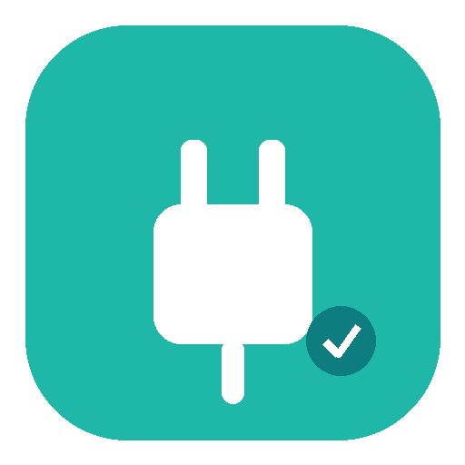

  
  <h1>TP-Link Third-Party Compatibility for Home Assistant</h1>
  
Keeps TP-Link / Kasa plugs on the Home Assistant compatible protocol, and auto-heals a plug that firmware-flips to TPAP.

  
  
  
  

⚠️ 🚨 **Unofficial integration. Not affiliated with or endorsed by TP-Link.** 🚨 ⚠️

---

## Table of Contents

- [Why](#why)
- [Features](#features)
- [Requirements](#requirements)
- [Installation](#installation)
- [Configuration](#configuration)
- [Entities](#entities)
- [How it works](#how-it-works)
- [Troubleshooting](#troubleshooting)
- [Credits and license](#credits-and-license)

---

## Why

Some Kasa plugs firmware-flip the account setting **Me, Third-Party Compatibility** off. That puts the plug on TPAP and breaks the local `tplink` integration with a `403` at `handshake1`. The only documented fix is to toggle the setting back on in the Kasa app by hand, every time it happens. This integration does it for you.

## Features

- **One switch per plug** for Home Assistant compatibility (on = HA compatible, off = TPAP).
- **Compatibility-state sensor** per plug (`compatible`, `tpap`, `unknown`) for dashboards and automations.
- **Automatic self-heal**: when a plug flips to TPAP, compatibility is re-enabled on the next poll. Turn it off in Options for manual control.
- **Two-factor sign-in** supported: if TP-Link challenges with MFA, you enter the emailed code once and the device is trusted after that.
- **Cloud polling only**: it does not touch your plugs locally and does not need the Kasa app running.

## Requirements

| Requirement | Detail |
|---|---|
| Home Assistant | 2024.1.0 or newer |
| Account | A Kasa / TP-Link account that owns the plugs |
| Network | Outbound HTTPS to the TP-Link cloud |

## Installation

1. Click the badge above, or in HACS open the three-dot menu, choose **Custom repositories**, and add `https://github.com/Emkraan/homeassistant-tplink-tpap` as an **Integration**.
2. Install **TP-Link Third-Party Compatibility**, then restart Home Assistant.
3. Go to **Settings -> Devices & Services -> Add Integration** and pick **TP-Link Third-Party Compatibility**.

## Configuration

Sign in with your Kasa / TP-Link email and password. If the account uses two-factor authentication, TP-Link emails a code and the setup asks for it once; this device is then trusted so later sign-ins skip the step. Credentials are stored in Home Assistant and used only for the compatibility calls.

Options (gear icon on the integration) let you turn **auto-heal** off if you prefer to flip compatibility by hand.

## Entities

Per plug:

| Entity | Type | Purpose |
|---|---|---|
| Home Assistant compatibility | `switch` | Turn HA compatibility on or off for that plug |
| Compatibility state | `sensor` (diagnostic) | `compatible`, `tpap`, or `unknown` |

## How it works

It talks to the TP-Link NBU IoT cloud, the same calls the Kasa app makes: a classic account login, then account-level and per-device compatibility settings on the regional app server. Setting compatibility on is a `POST` of `homeAssistantCompatibility`; the per-device preference is a `PATCH` of `thirdPartyCompatibility`.

## Troubleshooting

- **Setup says the code was wrong**: request a fresh code (re-run setup) and enter the newest one; codes expire quickly.
- **A plug still shows unavailable in the `tplink` integration**: give the self-heal one poll cycle, or toggle the plug's compatibility switch on manually. The Kasa-app toggle is always a valid fallback.
- Turn on debug logging for `custom_components.tplink_tpap` to see the cloud calls.

## Credits and license

The classic cloud login signing is vendored from [piekstra/tplink-cloud-api](https://github.com/piekstra/tplink-cloud-api) (GPL-3.0). This project is therefore licensed **GPL-3.0**. Not affiliated with or endorsed by TP-Link.
